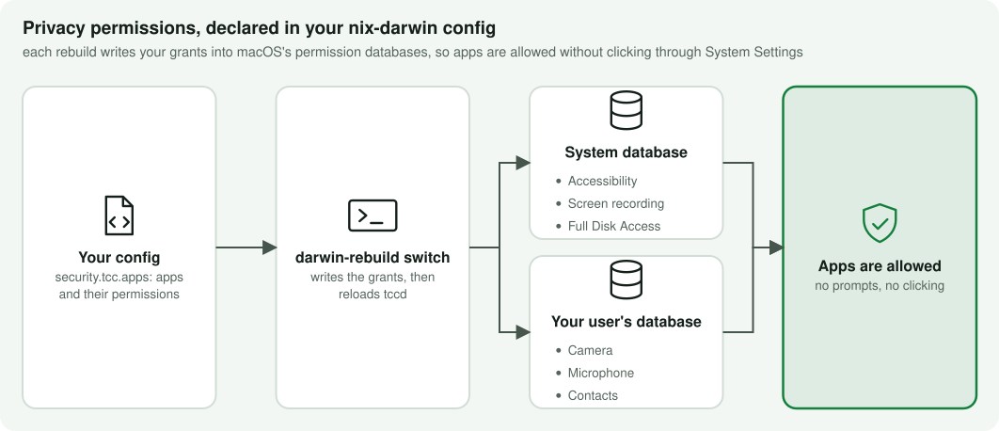
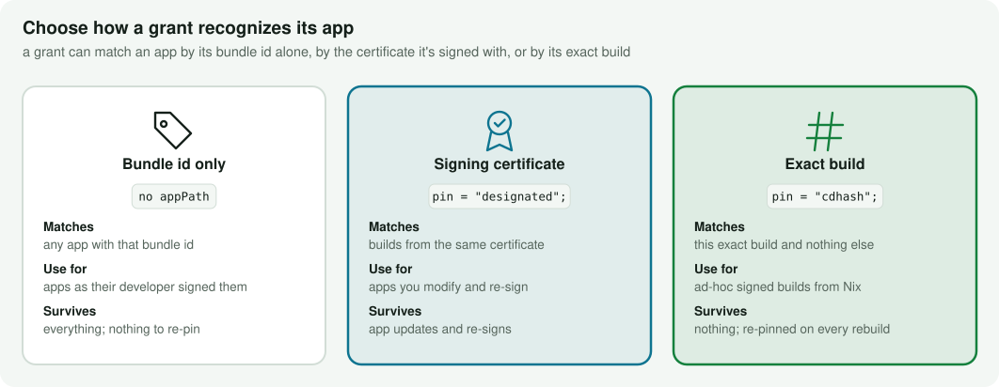
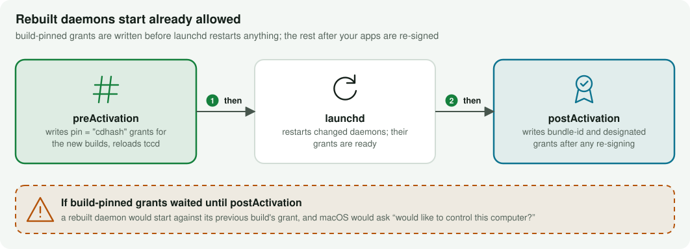

# nix-darwin-tcc

[](https://github.com/xav-ie/nix-darwin-tcc/actions/workflows/ci.yml)
[](LICENSE)

**macOS privacy permissions as part of your [nix-darwin] config.** Camera,
microphone, screen recording, accessibility, Full Disk Access and the rest are
granted at every rebuild, so a fresh Mac or a rebuilt app never stops to ask.

<!-- diagram:what-it-does -->
<picture>
  <source media="(prefers-color-scheme: dark)" srcset="docs/diagrams/what-it-does-dark.svg">
  
</picture>
<!-- /diagram:what-it-does -->

## Why

macOS keeps these permissions (TCC: Transparency, Consent & Control) in its own
databases, and the only supported way to fill them is clicking through prompts
and System Settings. That doesn't survive a reinstall, a second Mac, or an app
you rebuild with Nix, whose new build macOS treats as a stranger. This module
writes the grants directly at activation instead, pinned to the app's code
signature when you want it to be.

## Quick start

```nix
{
  inputs = {
    nixpkgs.url = "github:NixOS/nixpkgs/nixpkgs-unstable";
    nix-darwin.url = "github:nix-darwin/nix-darwin";
    nix-darwin.inputs.nixpkgs.follows = "nixpkgs";
    # Has no inputs of its own: nothing to follow, nothing added to your lock.
    nix-darwin-tcc.url = "github:xav-ie/nix-darwin-tcc";
  };

  outputs = { nix-darwin, nix-darwin-tcc, ... }: {
    darwinConfigurations.my-mac = nix-darwin.lib.darwinSystem {
      modules = [
        nix-darwin-tcc.darwinModules.default
        {
          system.primaryUser = "alice";
          security.tcc = {
            enable = true;
            apps = [
              { bundleId = "us.zoom.xos"; services = [ "Camera" "Microphone" "ScreenCapture" ]; }
              { bundleId = "com.mitchellh.ghostty"; services = [ "Accessibility" "FullDiskAccess" ]; }
            ];
          };
        }
      ];
    };
  };
}
```

Then `darwin-rebuild switch`. Grants to the system database need SIP disabled;
see [Requirements](#requirements-and-caveats).

## Choosing a pin

<!-- diagram:pinning -->
<picture>
  <source media="(prefers-color-scheme: dark)" srcset="docs/diagrams/pinning-dark.svg">
  
</picture>
<!-- /diagram:pinning -->

Without `appPath`, a grant matches by bundle id, which is right for apps as
their developer signed them. Set `appPath` to pin the grant to the app's code
signature:

- **`pin = "designated"`** (the default once `appPath` is set) reads the
  bundle's designated requirement at activation. It's anchored to the signing
  certificate, so it keeps matching across updates and cert rotation. Use it for
  apps you modify and re-sign, for example a browser bundle you patch: a broken
  or ad-hoc seal makes `tccd` deny camera, microphone and screen recording, so
  such an app has to be re-signed with a real certificate before activation.
- **`pin = "cdhash"`** pins the exact build. Use it for ad-hoc signed apps and
  daemons you build with Nix, which have no certificate to anchor to. Every
  rebuild has a new cdhash, and the grant is re-pinned on every activation.

```nix
{
  bundleId = "com.example.my-daemon";
  appPath = "${pkgs.my-daemon}/Applications/MyDaemon.app";
  pin = "cdhash";
  services = [ "Accessibility" ];
}
```

## Activation order

<!-- diagram:activation-order -->
<picture>
  <source media="(prefers-color-scheme: dark)" srcset="docs/diagrams/activation-order-dark.svg">
  
</picture>
<!-- /diagram:activation-order -->

nix-darwin activation runs `preActivation`, then reloads launchd agents and
daemons, then `postActivation`. cdhash pins name an immutable store bundle, so
they're written first: a rebuilt daemon is relaunched with its new grant already
in place. Everything else waits for `postActivation`, after any re-signing.
`tccd` is reloaded so new rows take effect without logging out.

## Options

| Option | Default | |
|---|---|---|
| `security.tcc.enable` | `false` | Turn the module on. |
| `security.tcc.user` | `system.primaryUser` | User whose per-user database is written and whose `tccd` is reloaded. |
| `security.tcc.package` | `tcc-grant` from your nixpkgs | The tool the activation scripts run. |
| `security.tcc.apps` | `[ ]` | The grants, below. |

Each entry of `apps`:

| Field | Default | |
|---|---|---|
| `bundleId` | | The app's bundle identifier. |
| `services` | `[ "Camera" "Microphone" ]` | Any of: Camera, Microphone, ScreenCapture, Accessibility, AppleEvents, InputMonitoring, PostEvent, AddressBook, Calendar, Reminders, Photos, SpeechRecognition, FullDiskAccess, DeveloperTool, DownloadsFolder, DesktopFolder, DocumentsFolder, Location, FocusStatus. |
| `appPath` | `""` | Path to the `.app`. When set, the grant is pinned to its code signature. |
| `pin` | `"designated"` | `"designated"` or `"cdhash"`; only used with `appPath`. |
| `resignIdentity` | `""` | Informational: the codesign identity whatever owns the app re-signs it with. Not read by this module. |

## Requirements and caveats

- **SIP disabled** (`csrutil disable` from Recovery) for grants to the system
  database, `/Library/Application Support/com.apple.TCC/TCC.db`: Accessibility,
  FullDiskAccess, ScreenCapture, InputMonitoring, PostEvent and DeveloperTool.
  Other services go to the user's own database under
  `~/Library/Application Support/com.apple.TCC/`.
- **Private schema.** This writes Apple's TCC database directly. It works on
  macOS Sequoia and Tahoe, but any macOS release can change it.
- **Additive.** Allows you granted in System Settings are left alone, and
  removing an app from `apps` doesn't revoke its grant.
- **What's tested.** Developed and used on macOS Tahoe (26) with SIP disabled,
  with grants in both databases and all three kinds of pin; not every service
  has been exercised. Writing the user database with SIP enabled (it may need
  Full Disk Access for the activating process instead) hasn't been tested.

## tcc-grant on its own

The module builds `tcc-grant` from your nixpkgs. To use it directly, add
`nix-darwin-tcc.overlays.default` to your overlays for `pkgs.tcc-grant`, or run
it from the dev flake:

```sh
nix run "github:xav-ie/nix-darwin-tcc?dir=dev#tcc-grant" -- --help
sudo tcc-grant --service Accessibility --bundle-id com.example.app \
  --db "/Library/Application Support/com.apple.TCC/TCC.db"
```

## Development

The main flake has no inputs. Checks, a standalone `tcc-grant` build and the
docs tooling live in the [`dev/`](dev/flake.nix) flake:

```sh
nix flake check ./dev        # module evaluation, tcc-grant build, diagrams up to date
nix develop ./dev -c node scripts/diagrams.mjs   # regenerate the diagrams
```

The diagrams are generated from [`scripts/diagrams.mjs`](scripts/diagrams.mjs)
and [`assets/palette.json`](assets/palette.json); edit those, not the SVGs.

## License

[MIT](LICENSE)

[nix-darwin]: https://github.com/nix-darwin/nix-darwin
